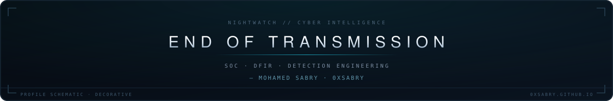

<p align="center">
  <picture>
    <source media="(max-width: 760px)" srcset="assets/banner-mobile.svg">
    
  </picture>
</p>

<p align="center">
  <strong>Mohamed Sabry</strong> &nbsp;·&nbsp; cybersecurity &nbsp;·&nbsp; detection engineering &nbsp;·&nbsp; DFIR<br/>
  <sub>I build detection systems that turn raw telemetry into evidence — and evidence into decisions.</sub>
</p>

<p align="center">
  
</p>

## 01 · Opening Transmission

```text
0xsabry@nightwatch:~$ whoami
mohamed sabry — cybersecurity / blue team / cairo, eg

0xsabry@nightwatch:~$ cat focus.txt
detection engineering · incident response · digital forensics · security automation

0xsabry@nightwatch:~$ ls ~/work
threatscopex/    ir-report-generator/    soc-soar-lab/    dfir-cases/
```

I'm early in this field and deliberate about how I build it: labs first, evidence second, claims last. Most of what I know comes from designing detection pipelines, writing my own tooling, and documenting investigations end to end — not from asserting expertise I haven't earned yet.

<p align="center">
  
</p>

## 02 · Operational Focus

| Domain | Work in practice |
| :--- | :--- |
| **Blue team & SOC** | Log ingestion, alert triage, event correlation and evidence capture in isolated lab environments |
| **Detection engineering** | Sigma and YARA rules, behavioral chains, MITRE ATT&CK mapping, false-positive tuning |
| **DFIR** | Disk and memory artifacts, timeline reconstruction, IOC extraction, structured case reporting |
| **Security automation** | Python tooling, webhook integrations, active-response actions, repeatable lab builds |
| **Network security** | Segmentation, VLAN / OSPF / ACL design, traffic analysis, management-plane hardening |
| **AI in security** | Studying hypothesis-driven investigation and LLM-assisted triage — studying, not production experience |

#### Field record

| Period | Role | Program |
| :--- | :--- | :--- |
| Aug 2026 – Sep 2026 | SOC Analyst Intern · FortiAnalyzer / FortiSIEM | NTI |
| Apr 2026 – present | Cybersecurity Intern · enterprise network hardening | ITI |
| Nov 2025 – Jul 2026 | Digital Forensics Trainee | DEPI |
| Oct 2025 – Sep 2026 | Cybersecurity Instructor · part-time | Zero2Aura |
| Oct 2024 – May 2025 | Incident Response Trainee | DEPI |
| Aug 2026 – present | Training & Technical Lead · volunteer | Th3 N3ST |

#### Education

**BSc Information Technology** · Egyptian E-Learning University (EELU) · 2022 – 2027 · final year

<p align="center">
  
</p>

## 03 · Selected Investigations

Four public projects that best represent how I work — the problem, the implementation, and what is actually inside the repository.

### CASE 01 — ThreatScopeX
**A detection engine for heterogeneous logs** &nbsp;·&nbsp; `ACTIVE` &nbsp;·&nbsp; `Python` `Sigma` `YARA` `STIX 2.1`

> **Problem** — Windows, Linux and application logs arrive in different formats, get triaged in different tools, and the timeline is rebuilt by hand.
> **Built** — Multi-platform parsers, Sigma and YARA rule execution, behavioral-chain detection, causal process graphs, deep forensic artifact parsers (Prefetch, $MFT, Shimcache, Amcache), STIX 2.1 export, and both CLI and web interfaces.
> **Signal** — One pipeline carries raw logs through triage, investigation and intelligence export without leaving the tool.

**[Repository →](https://github.com/0xsabry/ThreatScopeX)**

### CASE 02 — Distributed SOC & SOAR Lab
**A five-node detection and response lab across separate networks** &nbsp;·&nbsp; `TEAM · COMPLETE`

> **Problem** — Single-machine labs prove a rule fires; they don't prove telemetry transport, enrichment and containment across a distributed estate.
> **Built** — As project lead and SIEM architect: Wazuh manager deployment and hardening, custom OSSEC detection rules, webhook integration and active-response bindings. The team added a Shuffle SOAR workflow, VirusTotal enrichment and red-team simulations against Linux, Windows and Windows Server targets.
> **Signal** — A documented, reproducible path from attack simulation to endpoint containment, with evidence artifacts at every stage.

**[Repository →](https://github.com/0xsabry/wazuh-shuffle-soar-soc-lab)** &nbsp;·&nbsp; **[Team credits →](https://github.com/0xsabry/wazuh-shuffle-soar-soc-lab#-team-roles--contributions)**

### CASE 03 — IR Report Generator
**A zero-dependency incident report builder** &nbsp;·&nbsp; `COMPLETE` &nbsp;·&nbsp; `HTML` `CSS` `JavaScript`

> **Problem** — Incident reports are assembled by hand from screenshots and notes, so structure and evidence quality vary from analyst to analyst.
> **Built** — A browser-only application that aggregates findings from 55+ security tools across nine categories: incident metadata, timeline, IOC tracking, chain of custody, ATT&CK mapping, response actions and structured export.
> **Signal** — Runs from a single HTML entry point with no server or build step, and keeps evidence ordering explicit.

**[Repository →](https://github.com/0xsabry/IR-Report-Generator)**

### CASE 04 — DFIR Case File: ISO-Delivered JavaScript Dropper
**Static forensic examination of a weaponized ISO image** &nbsp;·&nbsp; `REPORT` &nbsp;·&nbsp; `Autopsy 4.22.1`

> **Problem** — A file disguised as a purchase-order PDF had to be examined without ever executing it.
> **Built** — A full case report under reference `INC-2026-0306-001`: double-extension spoofing, obfuscated JavaScript, WScript execution artifacts, registry persistence paths, MOTW evasion through the ISO container, negative findings, IOCs and ATT&CK mapping.
> **Signal** — A published investigation trail with an evidence gallery, severity findings and containment recommendations — not just a malware summary.

**[Case report →](https://github.com/0xsabry/digital-forensics-malware-investigation)**

#### Also in the archive

| Repository | What it shows |
| :--- | :--- |
| [SOC Lab Project](https://github.com/0xsabry/soc-lab-project) | Wazuh and ThreatScope driven through three simulated attack scenarios, with ATT&CK mapping and an exported case report |
| [Enterprise Network Hardening](https://github.com/0xsabry/enterprise-network-hardening-traffic-control) | Multi-VLAN, multi-area OSPF architecture with Extended ACLs and SSH hardening; Packet Tracer artifact and write-up included |
| [Portfolio](https://0xsabry.github.io/) | Project write-ups and reports collected in one place |

<p align="center">
  
</p>

## 04 · Technical Arsenal

| Layer | Tools |
| :--- | :--- |
| **SIEM & monitoring** | Wazuh · Splunk (lab) · Elastic (lab) · Microsoft Sentinel (lab) · FortiSIEM · FortiAnalyzer |
| **Detection & intelligence** | Sigma · YARA · MITRE ATT&CK · Suricata · Zeek · STIX 2.1 · VirusTotal |
| **DFIR** | Autopsy · Volatility 3 · KAPE · FTK Imager · Eric Zimmerman tools · Wireshark |
| **Network** | Cisco Packet Tracer · pfSense · VLAN / OSPF / ACL design · SSH hardening |
| **Engineering** | Python · Bash · PowerShell · Docker · Git · Linux · Windows |

#### Certifications

| Provider | Credentials |
| :--- | :--- |
| **Microsoft** | SC-900 · Cybersecurity Analyst Professional Certificate |
| **Google** | Cybersecurity Professional Certificate |
| **Cisco** | SOC · Junior Cybersecurity Analyst · CCNA 7 training · Threat Intelligence 101 (Talos) |
| **Huawei** | HCIA-Security · HCCDA Tech Essentials |
| **Other** | TryHackMe SOC Level 1 · Incident Handling & Response (MaharaTech) |

**Actively learning** — cloud telemetry, AI-assisted triage, and the Fortinet Security Operations track (FCP · NSE 6).

<p align="center">
  
</p>

## 05 · Current Work

| Workstream | State | Detail |
| :--- | :--- | :--- |
| **ThreatScopeX** | `ACTIVE` | Extending forensic parsers, causal process graphs and the AI-assisted investigation module |
| **Detection lab** | `COMPLETE` | Distributed Wazuh → Shuffle → active-response pipeline, documented for reproduction |
| **AI-assisted triage** | `STUDYING` | Hypothesis-driven investigation patterns, and where model output can actually be verified |
| **Fortinet SecOps discipline** | `PREPARING` | FCP – Security Operations and NSE 6 FortiSIEM Analyst |

<p align="center">
  
</p>

## 06 · Engineering Philosophy

**Evidence over narrative.** Logs record what happened. A report should never describe what I hoped happened.

**A detection must explain itself.** If a rule cannot say why it fired — and what it would miss — it isn't finished.

**Automate repetition, investigate exceptions.** Machines should handle the thousandth alert; a human should own the strange one.

**Build the tool you needed at 02:00.** The most useful tooling comes from a real gap hit during a real investigation.

<p align="center">
  
</p>

## 07 · Contact

**Based in Cairo, Egypt — open to SOC, DFIR and detection engineering opportunities, and to collaboration on defensive tooling.**

[LinkedIn](https://www.linkedin.com/in/mohamed-sabry-hamdan/) &nbsp;·&nbsp; [GitHub](https://github.com/0xsabry)

<p align="center">
  <picture>
    <source media="(max-width: 760px)" srcset="assets/footer-mobile.svg">
    
  </picture>
</p>
